# SF Cards

**Sci‑fi "HUD" cards for Home Assistant** — a set of 13 Lovelace cards with a glowing, cinematic look: an animated energy core, room dials, a welcome bridge, a full‑frame red alert, popup tiles made for phones… and a **visual editor for every card**, so nobody has to write YAML.

[](https://hacs.xyz)
[](LICENSE)


<p align="center">
  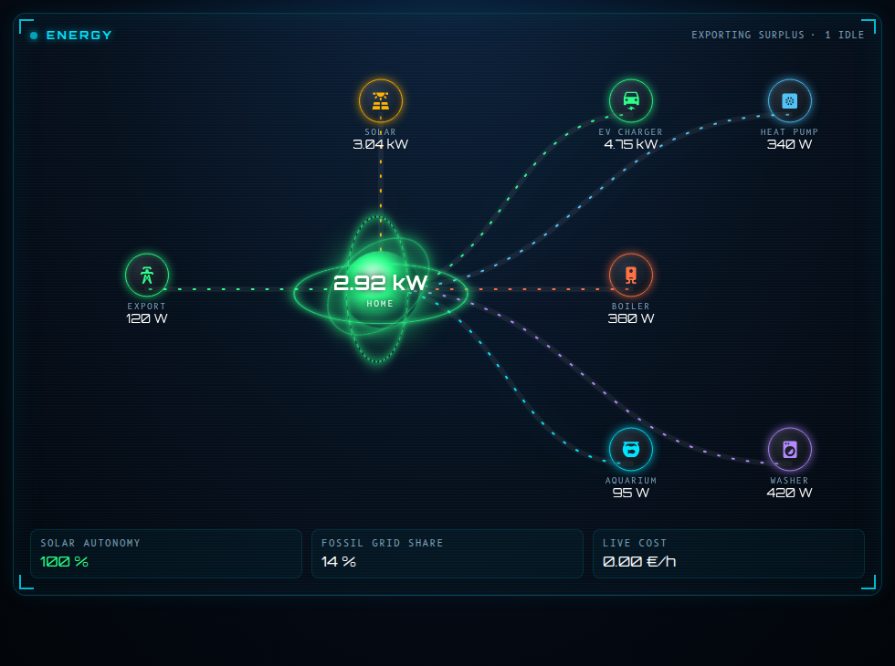
</p>

> **Made by Claude.** This whole project — the cards, the visual editors, the translations, the documentation and this README — was designed and written by **Claude** (Anthropic's AI, working through Claude Code) from the ideas, requests and feedback of **khrom06**, plus a few ideas of Claude's own. khrom06 steered every design decision, tested everything on a real Home Assistant installation and kept asking for "one more thing" until it looked right. See [Credits](#credits).

---

## Contents

- [Features](#features)
- [Installation](#installation) (HACS or manual)
- [The cards](#the-cards)
- [Visual editor](#visual-editor)
- [Languages](#languages)
- [Optional theme](#optional-theme)
- [About HACS and its future](#about-hacs-and-its-future)
- [Limitations](#limitations)
- [Credits](#credits) · [License](#license)

## Features

- **13 cards, one look** — cyan / amber / red / green neon on a deep‑blue background, Orbitron + B612 Mono fonts, corner brackets, scan lines, glow.
- **Visual editor for every card** — pick entities from drop‑downs, add / reorder / delete rooms, groups, tiles and devices with buttons. Advanced fields (service data, popup card…) stay editable as embedded YAML, and nothing you typed in YAML is ever lost by the editor.
- **Made for phones** — `sf-launcher-card` turns any card into a summary tile that opens in a bottom‑sheet popup (the phone's Back button closes it, `#hash` deep links work).
- **Dynamic layouts** — the energy card re‑flows by itself for 2 or 12 devices, on a phone or on a wall tablet; idle devices can be hidden automatically and the number of displayed devices is capped.
- **Eleven languages** — English, French, Spanish, German, Dutch, Italian, Portuguese, Polish, Russian, Chinese and Arabic (right-to-left), picked automatically from each user's Home Assistant profile (English for any other language).
- **No dependencies, no network** — a single JavaScript file; the two fonts are embedded (SIL OFL).
- **Safe by design** — a missing, `unknown` or `unavailable` entity shows a grey "—" / "no data", never a fake "OK".

## Installation

### Option A — HACS (custom repository)

1. In Home Assistant open **HACS**.
2. Menu **⋮ → Custom repositories**.
3. Repository: `https://github.com/khrom06/SF-Cards` — Type: **Dashboard** (called *Lovelace* in older HACS versions). Click **Add**.
4. Search for **SF Cards**, click **Download**.
5. **Reload your browser** (hard refresh, or restart the companion app). HACS registers the resource for you.

If your dashboards are in YAML mode, add the resource yourself:

```yaml
resources:
  - url: /hacsfiles/SF-Cards/sf-cards.js
    type: module
```

(The exact URL is shown in **Settings → Dashboards → ⋮ → Resources** once HACS has installed it.)

### Option B — manual

1. Download [`dist/sf-cards.js`](dist/sf-cards.js) and copy it to `/config/www/sf-cards.js`.
2. **Settings → Dashboards → ⋮ → Resources → Add resource**: URL `/local/sf-cards.js`, type **JavaScript module**.
3. Reload your browser.

Then edit a dashboard → **Add card** → search for **"SF ·"**.

## The cards

Every card can be configured in the visual editor; the YAML below is just for reference. Optional entities that you leave out are simply not displayed. Entity ids are placeholders.

| Card | What it is |
|---|---|
| [`sf-bridge-card`](#sf-bridge-card) | Welcome banner: clock, weather, tariff (peak / off‑peak + countdown), house mode, solar left, anomalies, presence |
| [`sf-reactor-card`](#sf-reactor-card) | Energy flow around an animated core: solar, grid, devices |
| [`sf-climate-card`](#sf-climate-card) | Room dials with target temperature, house mode, extra buttons |
| [`sf-console-card`](#sf-console-card) | Grouped controls: lights, dimmers, covers, vacuum, scripts, sensors |
| [`sf-launcher-card`](#sf-launcher-card) | Summary tiles that open any SF card in a popup — made for phones |
| [`sf-alert-card`](#sf-alert-card) | Full‑frame red alert: water leaks, doorbell, alarm, power cut |
| [`sf-hangar-card`](#sf-hangar-card) | EV(s) + shared charger, charge‑mode selector, energy flows |
| [`sf-machines-card`](#sf-machines-card) | Status tiles: values with thresholds, on/off, toggles with timers |
| [`sf-cells-card`](#sf-cells-card) | Weakest sensor batteries first, discovered automatically |
| [`sf-battery-card`](#sf-battery-card) | Home battery: level, flow, estimated time, daily energy, mode — only shows what you configure |
| [`sf-radiators-card`](#sf-radiators-card) | Radiators: preset, setpoint, heating state and daily energy — works without a temperature probe |
| [`sf-camera-card`](#sf-camera-card) | Camera mosaic with motion / person overlay |
| [`sf-setpoints-card`](#sf-setpoints-card) | Setpoint matrix per room (+ / −) |
| [`sf-ledger-card`](#sf-ledger-card) | Consumption per device and period |
| [`sf-radar-card`](#sf-radar-card) | Presence from three never‑merged sources (advanced) |

### sf-bridge-card

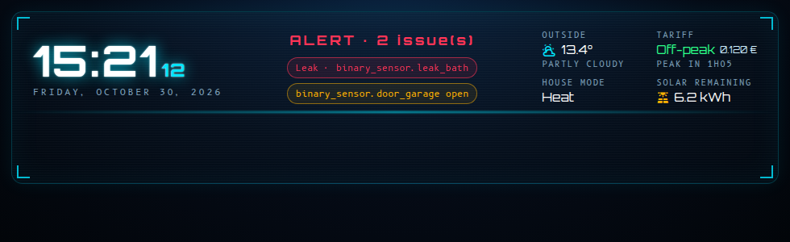

```yaml
type: custom:sf-bridge-card
weather: weather.home
outdoor: sensor.outdoor_temperature
price: sensor.electricity_price_now        # €/kWh — decides peak vs off-peak
hc_price: input_number.offpeak_price       # only used when no hc_windows are set: price == hc_price means off-peak
hc_windows:                                # off-peak hours — as many ranges as your contract has (2, 3…); they decide peak / off-peak and the countdown
  - { start: "00:56", end: "06:56" }
  - { start: "14:26", end: "16:26" }
mode: input_select.house_mode
solar_left: sensor.solar_energy_remaining_today
internet: binary_sensor.internet
power_in: sensor.ups_input_voltage         # alert below 200 V
leaks: [binary_sensor.leak_kitchen, binary_sensor.leak_bathroom]
doors: [binary_sensor.door_front, binary_sensor.door_garage]
people:                                    # optional presence row
  - { name: Alice, entity: person.alice }
home_states: [home]                        # states counted as "home" — add your custom zone name if it is smaller than the Home zone
```

### sf-reactor-card


```yaml
type: custom:sf-reactor-card
solar: sensor.solar_power
grid: sensor.grid_power            # positive = import, negative = export
battery_power: sensor.battery_power  # optional, W — positive = discharging (battery_invert: true to flip)
battery_soc: sensor.battery_level    # optional, %
# several batteries: batteries: [{ soc: sensor.a_level, power: sensor.a_power, capacity_kwh: 10 }, { … }]
fossil: sensor.grid_fossil_percent # optional
price: sensor.electricity_price_now
hide_idle: true                    # hide devices below idle_w (default 20 W)
max_devices: 8                     # keep the biggest consumers beyond this
devices:
  - { name: EV charger, entity: sensor.ev_power,   icon: "mdi:car-electric",   color: "#2bff88" }
  - { name: Heat pump,  entity: sensor.hp_power,   icon: "mdi:heat-pump",      color: "#4fc3f7" }
  - { name: Boiler,     entity: sensor.boiler_pwr, icon: "mdi:water-boiler",   color: "#ff7043" }
```

No solar panels? Leave `solar` out: the solar node, the flow and the "solar autonomy" figure disappear. The same goes for the footer figures (`fossil`, `price`), the bridge's "solar left" / house mode, the hangar's flows and the ledger's solar share: **anything you don't configure is not displayed**.

The layout adapts to the number of visible devices and to the width: up to three columns on a wide card, a grid under the core on a phone.

### sf-climate-card

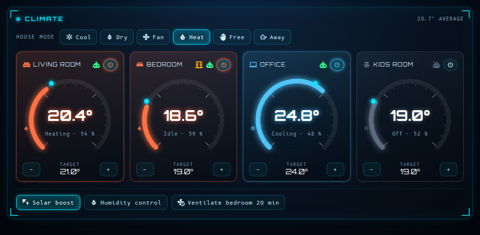

```yaml
type: custom:sf-climate-card
mode: input_select.house_mode              # optional house-mode selector
rooms:
  - name: Living room
    icon: mdi:sofa
    climate: climate.living_room
    temp: sensor.living_room_temperature   # optional (falls back to the climate entity)
    hum: sensor.living_room_humidity
    target: input_number.living_room_target # the ± buttons change this input_number
    regul: input_boolean.living_room_auto   # optional "auto regulation" flag
    window: binary_sensor.living_room_window
extras:
  - { label: Solar boost, entity: input_boolean.solar_boost, icon: "mdi:solar-power" }
  - label: Towel dryer
    entity: script.towel_dryer_45
    timer: timer.towel_dryer       # shows the remaining time, a tap stops it
    stop: [script.towel_dryer_45, switch.towel_dryer]
# switch_script: script.my_room_toggle   # optional; default = climate.turn_on / turn_off
```

### sf-console-card

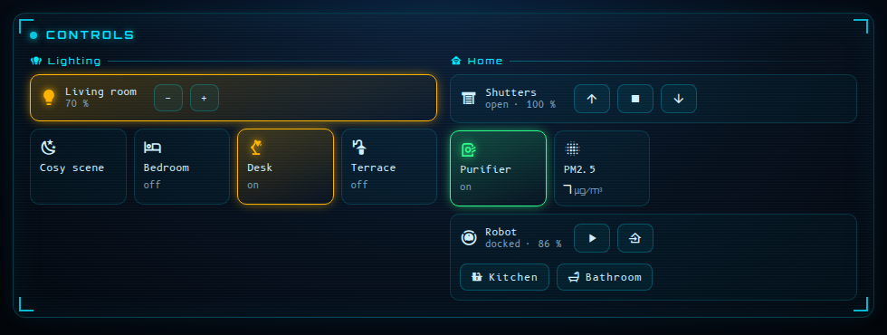

```yaml
type: custom:sf-console-card
title: Controls
groups:
  - title: Lighting
    icon: mdi:lightbulb-group
    items:
      - { kind: dimmer, entity: light.living_room, label: Living room }   # toggle + brightness ±10 %
      - { kind: toggle, entity: switch.desk_lamp, label: Desk, icon: "mdi:desk-lamp" }
      - { kind: action, label: Cosy, icon: "mdi:weather-night", service: scene.turn_on, data: { entity_id: scene.cosy } }
  - title: Home
    items:
      - { kind: cover, entity: cover.shutters, label: Shutters }
      - { kind: vacuum, entity: vacuum.robot, battery: sensor.robot_battery, label: Robot,
          shortcuts: [{ label: Kitchen, entity: button.robot_kitchen, icon: "mdi:countertop" }] }
      - { kind: sensor, entity: sensor.pm25, label: PM2.5, unit: "µg/m³" }
```

Item kinds: `toggle`, `dimmer`, `action`, `sensor`, `cover`, `vacuum`, `stepper`, `select`.

### sf-launcher-card

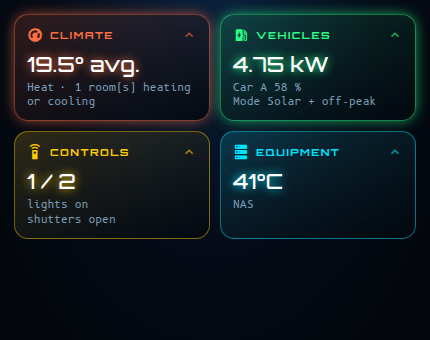

Each tile shows a live summary and opens a card in a popup — an SF card, a standard Home Assistant card (`vertical-stack`, `history-graph`…) or any other custom card:

```yaml
type: custom:sf-launcher-card
columns: 2
tiles:
  - name: Climate
    icon: mdi:thermostat
    color: "#ff7043"
    hash: climate            # deep link: …/dashboard/home#climate
    summary: climate         # climate | room | vehicles | commands | cameras | energy | machines | text
    card:                    # any SF card
      type: custom:sf-climate-card
      rooms: [ … ]
```

### sf-alert-card

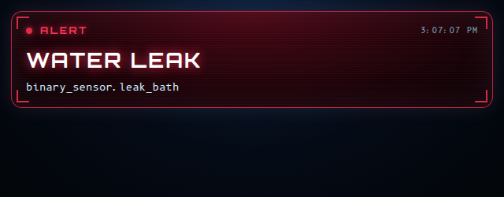

Calm and discreet when everything is fine (or hide it with a `conditional` card), full red and pulsing when something happens.

```yaml
type: custom:sf-alert-card
leaks: [binary_sensor.leak_kitchen, binary_sensor.leak_bathroom]
doors: [binary_sensor.door_front]        # informational
alarm: alarm_control_panel.home          # optional
ring: binary_sensor.doorbell             # optional
snapshot: camera.front_door              # optional photo shown on a ring
power: sensor.ups_input_voltage          # optional, alert below power_below (200 V)
hide_sim: true                           # hides the "simulate a doorbell" test button
```

### sf-hangar-card

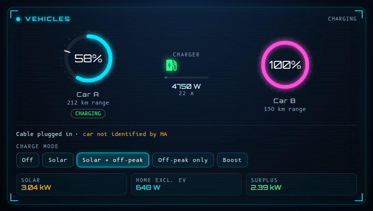

```yaml
type: custom:sf-hangar-card
cars:                                          # up to 3 cars
  - { name: Car A, soc: sensor.car_a_battery, range: sensor.car_a_range, target: sensor.car_a_target, charging: binary_sensor.car_a_charging, color: "#00e5ff" }
distance_unit: auto                            # auto (the range sensor's own unit) | km | mi — converts if needed
charger:
  connected: binary_sensor.charger_connected   # or a status sensor: "Connected", "Plugged in", "Awaiting start"…
  charging: binary_sensor.charger_charging     # or a status sensor: "Charging"… (optional: without it, power > 50 W means charging)
  # connected_states: [my_status]   # optional: replace the built-in list if your charger uses unusual status words
  # charging_states: [my_status]
  power: sensor.charger_power
  current: number.charger_current
  decision: sensor.charge_controller_decision   # optional
mode: input_select.charge_mode                  # optional selector — an input_select or a select entity
flows: { solar: sensor.solar_power, home: sensor.house_power, surplus: sensor.solar_surplus }
warn_mode: Solar                                # optional: warn when this mode is selected in the evening…
warn_text: "No sun tonight — the car will not charge in this mode."
```

**Two chargers (or more)?** Replace `charger:` with a `chargers:` list (up to 4). Each one has its own name, status, power, current, controller decision and, if you like, its own `mode` selector. The cars are shown in a row above, one block per charger below; the header says *charging* as soon as one charger charges, and the launcher tile adds up the power. The single `charger:` syntax keeps working.


```yaml
chargers:
  - { name: Garage,   connected: sensor.garage_status,   charging: sensor.garage_status,   power: sensor.garage_power,   current: number.garage_current }
  - { name: Driveway, connected: sensor.driveway_status, charging: sensor.driveway_status, power: sensor.driveway_power, mode: select.driveway_mode }
```

**Works with any charger and car integration.** "Plugged in" and "charging" accept `on` / `off` but also the status words most chargers publish — `Charging`, `Connected`, `Plugged in`, `Awaiting start`, `SuspendedEV`, `Charge done`… (case, spaces and dashes are ignored). If your brand uses something unusual, list the words in `connected_states` / `charging_states`. No status sensor at all? The card falls back on the charger power (above 50 W = charging). The car's own `charging` entity accepts the same words (`charging_states` per car).

### sf-machines-card

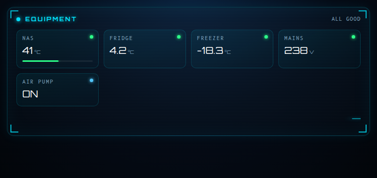

```yaml
type: custom:sf-machines-card
title: Equipment
tiles:
  - { label: NAS,    entity: sensor.nas_temperature, kind: value, digits: 0, warn: 55, crit: 65, max: 80 }
  - { label: Fridge, entity: sensor.fridge, kind: value, digits: 1, warn: 6, crit: 8 }
  - { label: Water,  entity: sensor.aquarium_temperature, kind: value, low: 24, warn: 26.5 }   # amber outside 24–26.5
  - { label: Pump,   entity: switch.pump, kind: toggle, color: "#4fc3f7" }
```

Tile kinds: `value`, `percent`, `binary`, `text`, `duration`, `timestamp`, `toggle`.

### sf-cells-card

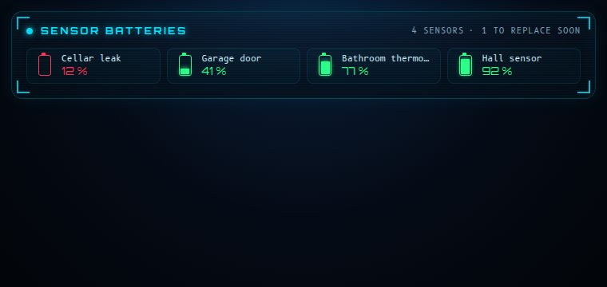

```yaml
type: custom:sf-cells-card
warn: 30
crit: 15
limit: 12
exclude: [sensor.some_battery]
include_pattern: ""      # optional regex on the entity id
```

### sf-battery-card

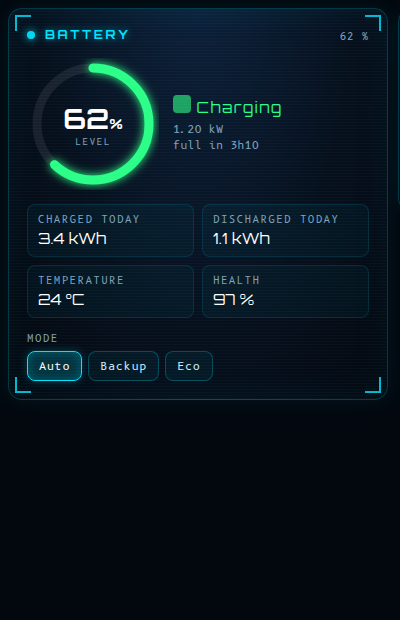

Home battery. Everything is optional — only configured entities are shown, and without `soc` or `power` the card hides itself.

```yaml
type: custom:sf-battery-card
soc: sensor.battery_level                  # %
power: sensor.battery_power                # W, positive = discharging (invert: true to flip)
capacity_kwh: 10                           # enables "full in 3h10 / empty in …"
charged_today: sensor.battery_charged_today        # kWh
discharged_today: sensor.battery_discharged_today  # kWh
mode: select.battery_mode                  # optional mode selector (select or input_select)
temperature: sensor.battery_temperature
health: sensor.battery_health
cycles: sensor.battery_cycles
```

**Several batteries?** List them under `batteries`. The ring shows the overall level (weighted by each battery's capacity — a simple average if a capacity is missing), the power is the sum, the estimated time uses the total capacity, and one compact row per battery appears under the ring. A battery that is unavailable is simply left out of the average.


```yaml
type: custom:sf-battery-card
batteries:
  - { name: Garage, soc: sensor.garage_battery_level, power: sensor.garage_battery_power, capacity_kwh: 10 }
  - { name: Cellar, soc: sensor.cellar_battery_level, power: sensor.cellar_battery_power, capacity_kwh: 5 }
  # invert: true on a battery flips its power sign (positive = discharging by default)
charged_today: sensor.total_battery_charged_today      # optional totals, as above
```

The single-battery fields (`soc`, `power`, `capacity_kwh`) keep working. The card also works as a launcher popup, with `summary: battery`.

The **energy card** shows the battery as one node: `battery_power` / `battery_soc` for one battery, or the same `batteries:` list for several (overall level, summed power) — a node per battery would make the diagram unreadable.

### sf-radiators-card

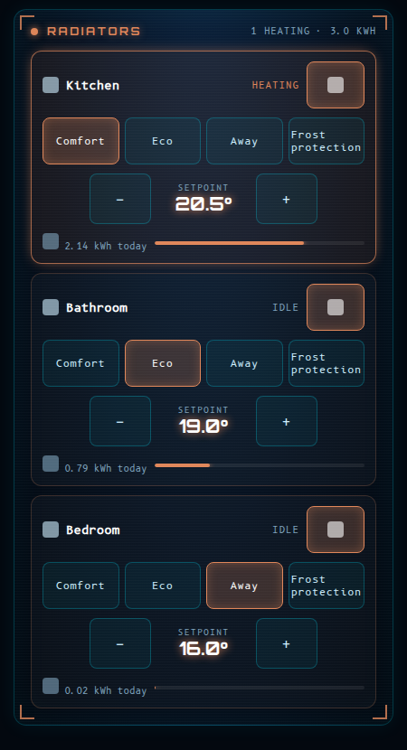

For radiators driven by presets (Voltalis, Netatmo, Tado…), which often have no room probe. One column and large touch targets, built for phones. Presets come from the device itself (`preset_modes`, or the options of a `select` entity); the setpoint buttons call `climate.set_temperature` and can be turned off for pilot-wire (fil pilote) heaters, which only know modes.

```yaml
type: custom:sf-radiators-card
title: Radiators
accent: "#e0875a"        # optional accent colour
step: 0.5                # setpoint step
max_kwh: 3               # daily energy that fills the bar
setpoint: true           # set false for pilot-wire heaters (no numeric setpoint): hides the ± control
preset_labels: { away: Frost protection }   # optional: rename presets
radiators:
  - name: Kitchen
    icon: mdi:countertop
    climate: climate.kitchen
    preset: select.kitchen_preset          # optional: use a select entity's options (may include "auto")
    presets: [auto, comfort, eco, away]    # optional: order / filter
    kwh: sensor.kitchen_energy_today       # optional (kWh or Wh)
    connection: sensor.kitchen_connection  # optional, warns when not ok/on/connected
```

### sf-camera-card

```yaml
type: custom:sf-camera-card
refresh: 5
cameras:
  - { entity: camera.front, name: Front, motion: binary_sensor.front_motion, persons: sensor.front_person_count, review: sensor.front_review_status }
```

### sf-setpoints-card

```yaml
type: custom:sf-setpoints-card
title: Setpoints
columns: [{ label: Day, color: "#ffb300" }, { label: Night, color: "#4fc3f7" }]
rows:
  - { name: Living room, icon: "mdi:sofa", entities: [input_number.living_day, input_number.living_night] }
```

### sf-ledger-card

```yaml
type: custom:sf-ledger-card
period: input_select.energy_period
total_cost: sensor.energy_cost
solar_fraction: sensor.solar_fraction
avg_price: sensor.average_price
devices:
  - name: EV charger
    icon: mdi:car-electric
    total: sensor.ev_kwh          # period total
    edf: sensor.ev_kwh_grid       # part bought from the grid ("edf" is the historical key name)
    solar: sensor.ev_kwh_solar    # part supplied by solar
    cost: sensor.ev_cost
```

### sf-radar-card

Advanced and opinionated: three rings, three sources that are **never merged** (home/away from `person.*`, last camera that recognised a face, anonymous room occupancy).

```yaml
type: custom:sf-radar-card
people: [{ name: Alice, person: person.alice, face: sensor.alice_last_camera, color: "#00e5ff" }]
rooms:  [{ label: Living room, entity: binary_sensor.living_room_occupancy }]
```

## Visual editor

Edit a dashboard, open any SF card and switch to the **visual editor**:

- fields are real Home Assistant pickers (entities filtered by domain, icons, numbers, toggles);
- lists (rooms, groups, items, tiles, devices, cameras…) have **+ Add**, **↑ / ↓** and a **two‑tap Delete** (the first tap arms it, so you can't delete by accident);
- in the launcher, each tile's popup content is chosen from a menu and edited with the *editor of that card*, nested;
- rarely used fields (service data, shortcuts…) are YAML boxes inside the form;
- the editor changes the configuration in place and never drops a field it doesn't know.

## Languages

The cards speak **English, French, Spanish, German, Dutch, Italian, Portuguese, Polish, Russian, Chinese (simplified) and Arabic**. The language follows the **Home Assistant profile of the person looking at the dashboard** (*Profile → Language*), so two users of the same dashboard can see two languages. If HA is set to any other language, the cards fall back to **English**. Date and time formats follow the same locale.

Regional variants (`pt-BR`, `zh-Hans`…) use the language of the same family. Arabic switches the cards to right-to-left; diagrams and dials keep their natural orientation.

Texts coming from your own configuration (titles, labels, names) are of course shown as you typed them.

> The languages were chosen from available proxies (Home Assistant publishes no usage statistics per language): the countries behind most downloads and website traffic, and the languages of the HA frontend. The translations were written by Claude; **native speakers are very welcome to review and correct them**.

Want another language? Translations live in one table (`SF_T`, near the top of `dist/sf-cards.js`: *key = French text → `[English, Spanish, German, Dutch, Italian, Portuguese, Polish, Russian, Chinese, Arabic]`*). Pull requests are welcome.

## Optional theme

[`themes/sf_hud.yaml`](themes/sf_hud.yaml) dresses the **native** Home Assistant cards (history graphs, logbook, entities lists…) in the same colours. Copy it to `/config/themes/` (with `frontend: themes: !include_dir_merge_named themes` in `configuration.yaml`), reload themes, then set `theme: SF HUD` on a view.

## Development

```bash
./test/run.sh    # syntax + render of every card (4 languages, no-solar and empty scenarios, translations, popups) in headless Chrome
```

See the [changelog](CHANGELOG.md) for what changed in each version.

## About HACS and its future

At the time of writing (October 2026), Home Assistant is reported to be **bringing HACS into Core under the name "Marketplace"**, targeted for Home Assistant 2026.11. According to the coverage, existing HACS installations — custom repositories, update entities and dashboard resources — are supposed to **migrate automatically** on the first start after the update, and existing HACS links keep working. Custom cards are **not** being merged into Core's built‑in card set: they stay community content that Home Assistant does not test or support.

SF Cards is a plain JavaScript dashboard resource, so it works the same way with HACS, with Marketplace, or installed manually. Please double‑check the details in the official Home Assistant release notes once 2026.11 is out — they are still subject to change.

Sources: [Matter Alpha — "Home Assistant embraces HACS into core as the marketplace"](https://www.matteralpha.com/news/home-assistant-embraces-hacs-into-core-as-the-marketplace) · [Home Assistant community thread on integrating popular HACS custom cards into standard cards](https://community.home-assistant.io/t/integrating-popular-frontend-custom-cards-on-hacs-to-standard-ha-cards/741706).

## Limitations

- Developed and tested on **Home Assistant 2026.10** (Chrome and the iOS / Android companion apps). Older versions may work but have not been tried.
- The code comments in `dist/sf-cards.js` are still in French (the UI itself is translated).
- Screenshots use fictional demo data.
- No automated test suite yet — the visual editors were exercised with a mock `ha-form` in headless Chrome, and everything else on a real installation.
- `sf-radar-card` and the Frigate‑related options are tied to a specific setup and are documented as advanced.

## Credits

- **Written by Claude** (Anthropic — Claude Sonnet 5.5, through Claude Code): the cards, the visual editors, the translations, the screenshots pipeline, this README.
- **Ideas, direction, testing and feedback: [khrom06](https://github.com/khrom06)** — the sci‑fi look, the phone popups, the dynamic energy layout, the "hide what consumes nothing" idea, the languages, and a long list of *"what if we…?"* that shaped every card. Many of the best details here are theirs.
- Fonts: **Orbitron** (© The Orbitron Project Authors) and **B612 Mono** (© The B612 Project Authors), both under the SIL Open Font License 1.1 — see [THIRD_PARTY_NOTICES.md](THIRD_PARTY_NOTICES.md).
- Icons: Home Assistant's Material Design Icons.

## License

[MIT](LICENSE) © khrom06. Embedded fonts are under the [SIL OFL 1.1](THIRD_PARTY_NOTICES.md).
