# SF Cards

**Sci‑fi "HUD" cards for Home Assistant** — a set of 25 Lovelace cards with a glowing, cinematic look: an animated energy core, room dials, a welcome bridge, a full‑frame red alert, popup tiles made for phones… and a **visual editor for every card**, so nobody has to write YAML.

[](https://my.home-assistant.io/redirect/hacs_repository/?owner=khrom06&repository=SF-Cards&category=dashboard)
[](LICENSE)

[](https://khrom06.github.io/SF-Cards/)
[](https://my.home-assistant.io/redirect/hacs_repository/?owner=khrom06&repository=SF-Cards&category=dashboard)

<p align="center">
  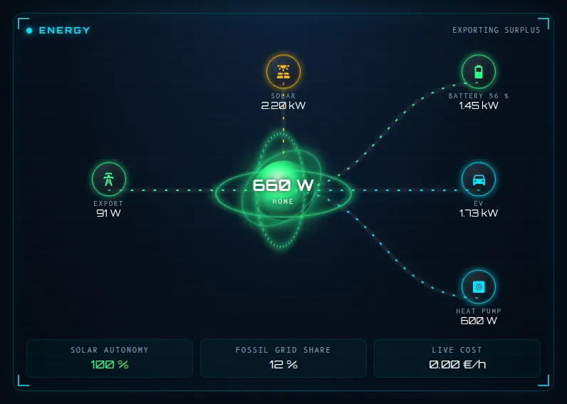
</p>

> **▶ [Try every card live, with fake data](https://khrom06.github.io/SF-Cards/)** — no install, 11 languages, light / dark.

### New in 1.19: four cards that answer everyday questions

<p align="center">
  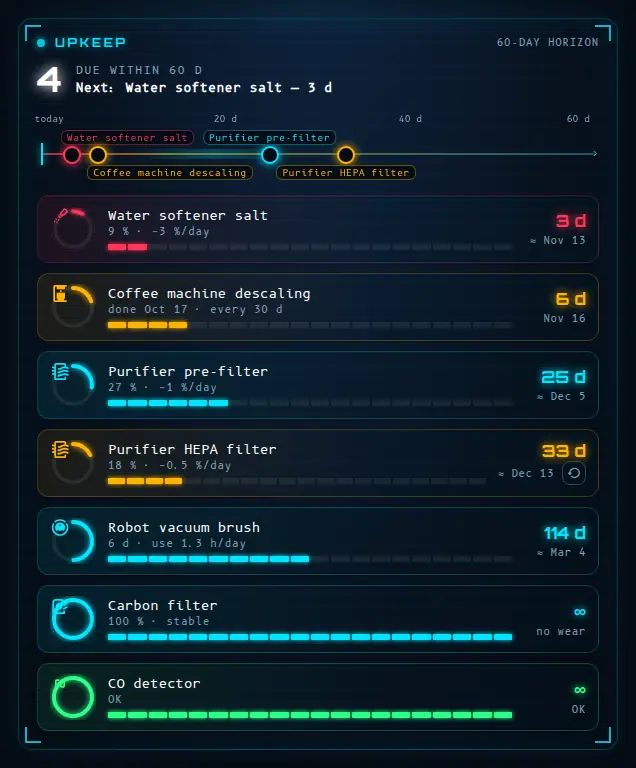 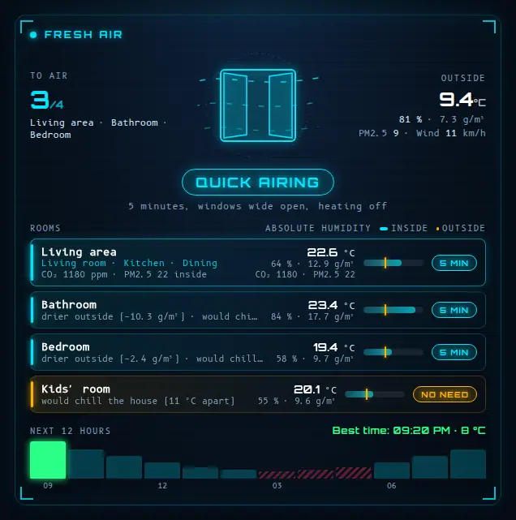
</p>
<p align="center">
  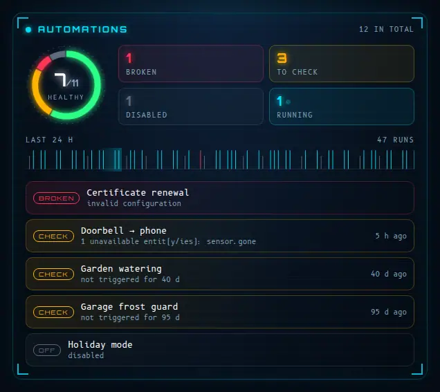 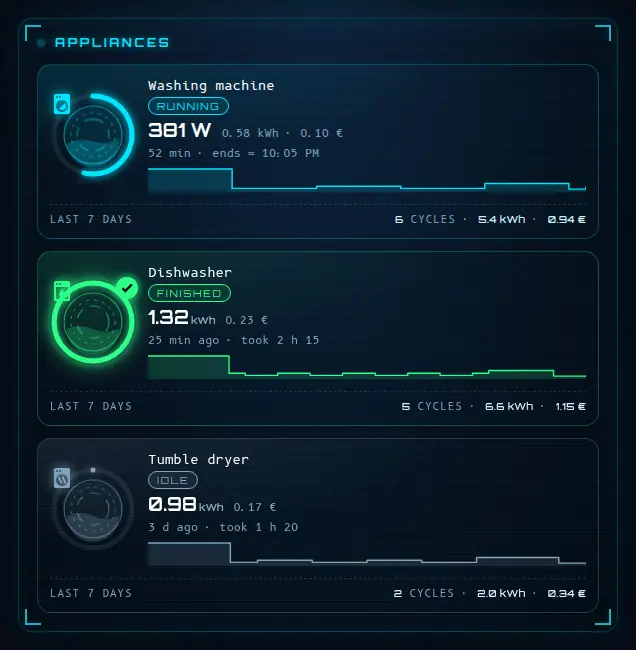
</p>

- **[Upkeep](#sf-upkeep-card)** — *"When do I change that filter?"* Learns how fast each filter, brush or consumable wears from its own history and predicts the date.
- **[Fresh air](#sf-air-card)** — *"Should I open the windows?"* One verdict per room from indoor / outdoor absolute humidity, CO₂, PM2.5, rain and wind, plus the best hour; window sensors confirm you are airing, or tell you to close.
- **[Automations](#sf-automations-card)** — *"Is everything still working?"* Broken, failing, silent and disabled automations at a glance, with a 24 h pulse of runs.
- **[Appliance cycles](#sf-cycles-card)** — *"When will the washing machine be done?"* Detects cycles from a power plug, estimates the time left from past cycles and shows the cost.

### A dashboard for wall panels (NSPanel Pro, 480×480 and other small screens)

`sf-ns-card` fills a whole square panel and **changes with the time of day**:

<p align="center">
  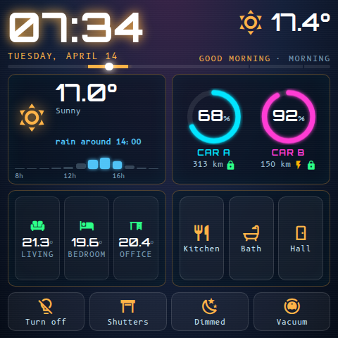 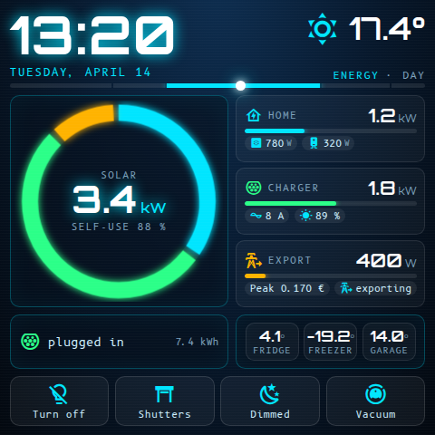 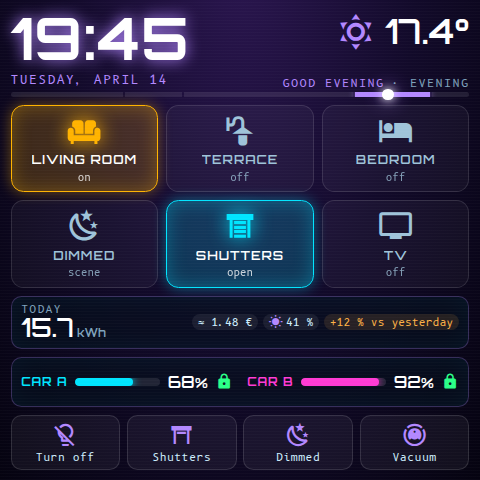 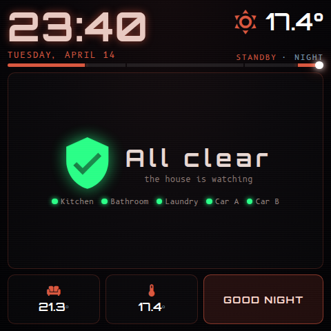
</p>

[Jump to the card](#sf-ns-card)

> **Made by Claude.** This whole project — the cards, the visual editors, the translations, the documentation and this README — was designed and written by **Claude** (Anthropic's AI, working through Claude Code) from the ideas, requests and feedback of **khrom06**, plus a few ideas of Claude's own. khrom06 steered every design decision, tested everything on a real Home Assistant installation and kept asking for "one more thing" until it looked right. See [Credits](#credits).

---

## Contents

- [Features](#features)
- [Installation](#installation) (Marketplace / HACS or manual)
- [The cards](#the-cards)
- [Visual editor](#visual-editor)
- [Languages](#languages) · [Light theme](#light-theme) · [Layout](#layout) · [Accessibility](#accessibility) · [Numbers](#numbers)
- [Optional theme](#optional-theme) · [Requirements](#requirements) · [Security](#security) · [Development](#development)
- [About HACS and Marketplace](#about-hacs-and-marketplace)
- [Limitations](#limitations)
- [Credits](#credits) · [License](#license)

## Features

- **25 cards, one look** — cyan / amber / red / green neon on a deep‑blue background, Orbitron + B612 Mono fonts, corner brackets, scan lines, glow.
- **Visual editor for every card** — pick entities from drop‑downs, add / reorder / delete rooms, groups, tiles and devices with buttons. Advanced fields (service data, popup card…) stay editable as embedded YAML, and nothing you typed in YAML is ever lost by the editor.
- **Made for phones** — `sf-launcher-card` turns any card into a summary tile that opens in a bottom‑sheet popup (the phone's Back button closes it, `#hash` deep links work).
- **Dynamic layouts** — the energy card re‑flows by itself for 2 or 12 devices, on a phone or on a wall tablet; idle devices can be hidden automatically and the number of displayed devices is capped.
- **Eleven languages** — English, French, Spanish, German, Dutch, Italian, Portuguese, Polish, Russian, Chinese and Arabic (right-to-left), picked automatically from each user's Home Assistant profile (English for any other language).
- **Light or dark** — dark neon by default; `theme: light` or `auto` (follows the Home Assistant theme) per card, or once for all cards with a CSS variable.
- **Accessible** — keyboard and screen-reader friendly (real buttons, focus ring, Enter / Space), respects *reduce motion*, alert levels are spelled out, popups are proper dialogs.
- **No dependencies, no external resources** — a single JavaScript file; the two fonts are embedded (SIL OFL).
- **Safe by design** — a missing, `unknown` or `unavailable` entity shows a grey "—" / "no data", never a fake "OK".

## Installation

### Option A — Marketplace (Home Assistant 2026.11 and later) or HACS

SF Cards is in the default catalogue, so there is nothing to add by hand:

1. Open **Marketplace** (or **HACS** on older versions).
2. Search for **SF Cards** and click **Download** (or **Install**).
3. **Reload your browser** (hard refresh, or restart the companion app). The dashboard resource is registered for you.

[](https://my.home-assistant.io/redirect/hacs_repository/?owner=khrom06&repository=SF-Cards&category=dashboard)

Updates then show up like any other update in **Settings**.

If your dashboards are in YAML mode, add the resource yourself (the exact URL is shown in **Settings → Dashboards → ⋮ → Resources** once installed):

```yaml
resources:
  - url: /hacsfiles/SF-Cards/sf-cards.js
    type: module
```

### Option B — manual

1. Download [`dist/sf-cards.js`](dist/sf-cards.js) and copy it to `/config/www/sf-cards.js`.
2. **Settings → Dashboards → ⋮ → Resources → Add resource**: URL `/local/sf-cards.js`, type **JavaScript module**.
3. Reload your browser.

Then edit a dashboard → **Add card** → search for **"SF ·"**.

## The cards

Every card can be configured in the visual editor; the YAML below is just for reference. Optional entities that you leave out are simply not displayed. Entity ids are placeholders.

| Card | What it is |
|---|---|
| [`sf-home-banner-card`](#sf-home-banner-card) | Welcome banner: clock, weather, tariff (peak / off‑peak + countdown), house mode, solar left, anomalies, presence |
| [`sf-energy-flow-card`](#sf-energy-flow-card) | Energy flow around an animated core: solar, grid, devices |
| [`sf-climate-card`](#sf-climate-card) | Room dials with target temperature, house mode, extra buttons |
| [`sf-controls-card`](#sf-controls-card) | Grouped controls: lights, dimmers, covers, vacuum, scripts, sensors |
| [`sf-launcher-card`](#sf-launcher-card) | Summary tiles that open any card (SF, standard Home Assistant or custom) in a popup — made for phones |
| [`sf-alert-card`](#sf-alert-card) | Full‑frame red alert: water leaks, doorbell, alarm, power cut |
| [`sf-vehicles-card`](#sf-vehicles-card) | EV(s) + shared charger, charge‑mode selector, energy flows |
| [`sf-machines-card`](#sf-machines-card) | Status tiles: values with thresholds, on/off, toggles with timers |
| [`sf-cells-card`](#sf-cells-card) | Weakest sensor batteries first, discovered automatically |
| [`sf-assistant-card`](#sf-assistant-card) | State of an assistant: phase, last request, action, result, reply — works out of the box with Assist satellites (read-only) |
| [`sf-health-card`](#sf-health-card) | Overview of your own checks: overall verdict and anomalies by severity, grouped by subsystem |
| [`sf-host-card`](#sf-host-card) | Monitoring of a computer or server: CPU / GPU / memory gauges, VRAM, disk and swap bars, live network curve, power draw (read-only) |
| [`sf-timeline-card`](#sf-timeline-card) | Latest state changes of the chosen entities, grouped by day, in plain words (read-only) |
| [`sf-trend-card`](#sf-trend-card) | History curves (read-only): range buttons, several series on one chart or one line each, hover / touch readout |
| [`sf-battery-card`](#sf-battery-card) | Home battery: level, flow, estimated time, daily energy, mode — only shows what you configure |
| [`sf-radiators-card`](#sf-radiators-card) | Radiators: preset, setpoint, heating state and daily energy — works without a temperature probe |
| [`sf-camera-card`](#sf-camera-card) | Camera mosaic with motion / person overlay |
| [`sf-setpoints-card`](#sf-setpoints-card) | Setpoint matrix per room; tap a value to edit (slider, scope: value / program / room) |
| [`sf-ledger-card`](#sf-ledger-card) | Consumption per device and period |
| [`sf-presence-card`](#sf-presence-card) | Presence from three never‑merged sources (advanced) |
| [`sf-upkeep-card`](#sf-upkeep-card) | **New** · maintenance forecast: filters, brushes, consumables, service dates — learns the wear rate, one-tap reset |
| [`sf-air-card`](#sf-air-card) | **New** · "should I open the windows?" — one verdict per room, window sensors, best hour of the next 12 |
| [`sf-automations-card`](#sf-automations-card) | **New** · health of your automations: broken, failing, silent, disabled, running, 24 h pulse (read-only) |
| [`sf-cycles-card`](#sf-cycles-card) | **New** · appliance cycles from a power plug: live progress, time left, cost, last 7 days |
| [`sf-ns-card`](#sf-ns-card) | **Full‑screen dashboard for wall panels** (NSPanel Pro, 480×480): morning / day / evening / night modes, kiosk mode |

> **Friendly names (1.13).** Five cards were renamed with plainer names: `sf-reactor-card` → `sf-energy-flow-card`, `sf-hangar-card` → `sf-vehicles-card`, `sf-bridge-card` → `sf-home-banner-card`, `sf-console-card` → `sf-controls-card`, `sf-radar-card` → `sf-presence-card`. **The original names keep working forever** (same card, same options, same editor); the card picker and this documentation just use the new ones.

### sf-home-banner-card

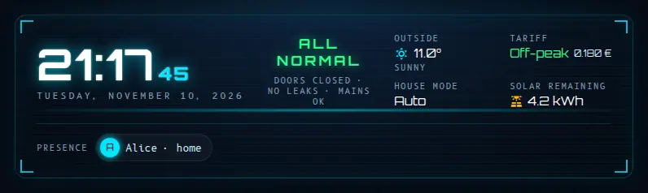

```yaml
type: custom:sf-home-banner-card
weather: weather.home
outdoor: sensor.outdoor_temperature
price: sensor.electricity_price_now        # €/kWh — decides peak vs off-peak
hc_price: input_number.offpeak_price       # only used when no hc_windows are set: price == hc_price means off-peak
hc_windows:                                # off-peak hours — as many ranges as your contract has (2, 3…); they decide peak / off-peak and the countdown
  - { start: "00:56", end: "06:56" }
  - { start: "14:26", end: "16:26" }
mode: input_select.house_mode
solar_left: sensor.solar_energy_remaining_today
internet: binary_sensor.internet
power_in: sensor.ups_input_voltage         # alert below 200 V
leaks: [binary_sensor.leak_kitchen, binary_sensor.leak_bathroom]
doors: [binary_sensor.door_front, binary_sensor.door_garage]
people:                                    # optional presence row
  - { name: Alice, entity: person.alice, color: "#00e5ff" }
footer: "text"                             # optional text on the right of the presence row
# legacy off-peak syntax, only read when hc_windows is empty: hc_start: "22:00" / hc_end: "06:00"
home_states: [home]                        # states counted as "home" — add your custom zone name if it is smaller than the Home zone
```

### sf-energy-flow-card


```yaml
type: custom:sf-energy-flow-card
solar: sensor.solar_power
grid: sensor.grid_power            # positive = import, negative = export
battery_power: sensor.battery_power  # optional, W — positive = discharging (battery_invert: true to flip)
battery_soc: sensor.battery_level    # optional, %
# several batteries: batteries: [{ soc: sensor.a_level, power: sensor.a_power, capacity_kwh: 10 }, { … }]
fossil: sensor.grid_fossil_percent # optional
price: sensor.electricity_price_now
hide_idle: true                    # hide devices below idle_w (default 20 W)
max_devices: 8                     # keep the biggest consumers beyond this
devices:
  - { name: EV charger, entity: sensor.ev_power,   icon: "mdi:car-electric",   color: "#2bff88" }
  - { name: Heat pump,  entity: sensor.hp_power,   icon: "mdi:heat-pump",      color: "#4fc3f7" }
  - { name: Boiler,     entity: sensor.boiler_pwr, icon: "mdi:water-boiler",   color: "#ff7043" }
```

No solar panels? Leave `solar` out: the solar node, the flow and the "solar autonomy" figure disappear. The same goes for the footer figures (`fossil`, `price`), the bridge's "solar left" / house mode, the hangar's flows and the ledger's solar share: **anything you don't configure is not displayed**.

The layout adapts to the number of visible devices and to the width: up to three columns on a wide card, a grid under the core on a phone.

### sf-climate-card

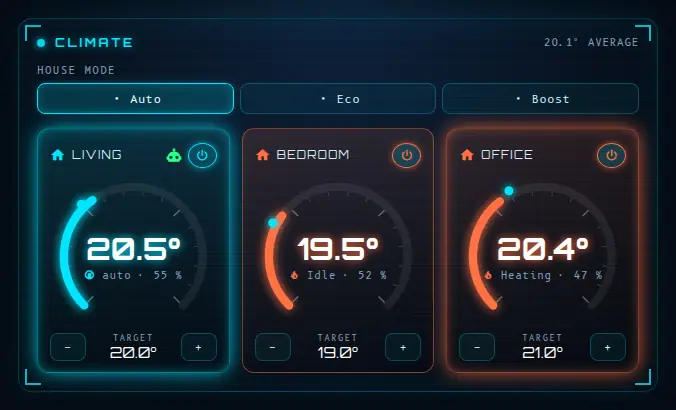

```yaml
type: custom:sf-climate-card
mode: input_select.house_mode              # optional house-mode selector
min: 15                                    # dial range (defaults 15 – 30 °C)
max: 30
rooms:
  - name: Living room
    icon: mdi:sofa
    climate: climate.living_room
    temp: sensor.living_room_temperature   # optional (falls back to the climate entity)
    hum: sensor.living_room_humidity
    target: input_number.living_room_target # the ± buttons change this input_number
    regul: input_boolean.living_room_auto   # optional "auto regulation" flag
    window: binary_sensor.living_room_window
extras:
  - { label: Solar boost, entity: input_boolean.solar_boost, icon: "mdi:solar-power" }
  - label: Towel dryer
    entity: script.towel_dryer_45
    timer: timer.towel_dryer       # shows the remaining time, a tap stops it
    stop: [script.towel_dryer_45, switch.towel_dryer]
# switch_script: script.my_room_toggle   # optional; default = climate.turn_on / turn_off
```

### sf-controls-card

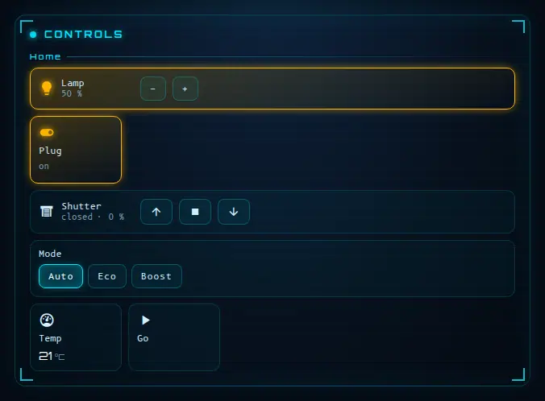

```yaml
type: custom:sf-controls-card
title: Controls
groups:
  - title: Lighting
    icon: mdi:lightbulb-group
    items:
      - { kind: dimmer, entity: light.living_room, label: Living room }   # toggle + brightness ±10 %
      - { kind: toggle, entity: switch.desk_lamp, label: Desk, icon: "mdi:desk-lamp" }
      - { kind: action, label: Cosy, icon: "mdi:weather-night", service: scene.turn_on, data: { entity_id: scene.cosy } }
  - title: Home
    items:
      - { kind: cover, entity: cover.shutters, label: Shutters }
      - { kind: vacuum, entity: vacuum.robot, battery: sensor.robot_battery, label: Robot,
          shortcuts: [{ label: Kitchen, entity: button.robot_kitchen, icon: "mdi:countertop" }] }
      - { kind: sensor, entity: sensor.pm25, label: PM2.5, unit: "µg/m³" }
```

Item kinds: `toggle`, `dimmer`, `action`, `sensor`, `cover`, `vacuum`, `stepper`, `select`.

Other options: card `subtitle`; group `span` (1–4 columns); item `color`, `digits`, `unit`; for `action`: `sub` and `confirm: "text"` (asks for a second tap); for `select`: `labels: { option: Label }`.

### sf-launcher-card

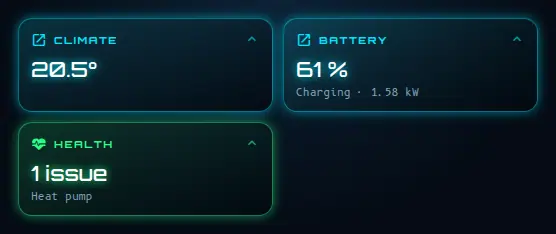

Each tile shows a live summary and opens a card in a popup — an SF card, a standard Home Assistant card (`vertical-stack`, `history-graph`…) or any other custom card:

```yaml
type: custom:sf-launcher-card
columns: 2
mode_entity: input_select.day_mode   # optional: adaptive mode (see below)
tiles:
  - name: Climate
    icon: mdi:thermostat
    color: "#ff7043"
    modes: [Morning, Evening]   # optional: highlighted (and moved first) while the mode entity is in one of these states
    hash: climate            # deep link: …/dashboard/home#climate
    summary: climate         # climate | room | vehicles | commands | cameras | energy | battery | machines | text
    # sub: "free text"      # shown under the title when summary: text
    # users: [<user id>]     # optional: tile visible only to these users
    card:                    # any card: SF, standard Home Assistant (vertical-stack, history-graph…) or custom
      type: custom:sf-climate-card
      rooms: [ … ]
```

`summary: health` shows the verdict of a health card's checks on the tile ("All good" / "2 anomalies" + the first names; red and pulsing when a critical check fails): put the `sf-health-card` config in the tile's `card`.

With `mode_entity` (any `input_select` / `select` / `sensor`, e.g. Morning / Day / Evening / Night) the tiles whose `modes` list the current state move to the front and get a brighter outline; the order changes back when the mode changes. Without `mode_entity`, or when the entity is unavailable or matches no tile, nothing changes.

### sf-alert-card

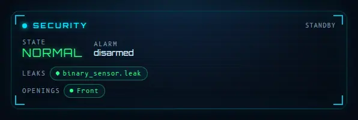

Calm and discreet when everything is fine (or hide it with a `conditional` card), full red and pulsing when something happens.

```yaml
type: custom:sf-alert-card
leaks: [binary_sensor.leak_kitchen, binary_sensor.leak_bathroom]
doors: [binary_sensor.door_front]        # informational
alarm: alarm_control_panel.home          # optional
ring: binary_sensor.doorbell             # optional
snapshot: camera.front_door              # optional photo shown on a ring
power: sensor.ups_input_voltage          # optional, alert below power_below (200 V)
hide_sim: true                           # hides the "simulate a doorbell" test button
```

### sf-vehicles-card

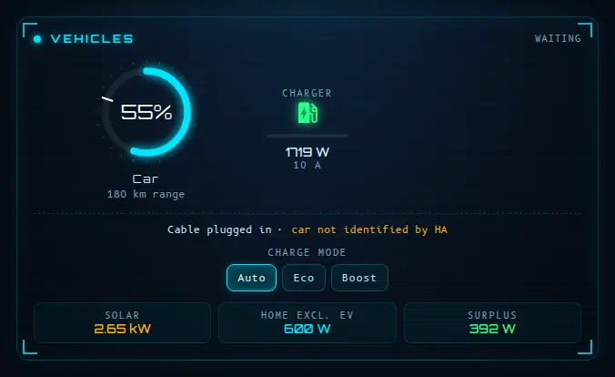

```yaml
type: custom:sf-vehicles-card
cars:                                          # up to 3 cars
  - { name: Car A, soc: sensor.car_a_battery, range: sensor.car_a_range, target: sensor.car_a_target, charging: binary_sensor.car_a_charging, color: "#00e5ff" }
distance_unit: auto                            # auto (the range sensor's own unit) | km | mi — converts if needed
charger:
  name: Garage                                 # optional
  connected: binary_sensor.charger_connected   # or a status sensor: "Connected", "Plugged in", "Awaiting start"…
  charging: binary_sensor.charger_charging     # or a status sensor: "Charging"… (optional: without it, power > 50 W means charging)
  # connected_states: [my_status]   # optional: replace the built-in list if your charger uses unusual status words
  # charging_states: [my_status]
  power: sensor.charger_power
  current: number.charger_current
  decision: sensor.charge_controller_decision   # optional
  mode: select.charger_mode                     # optional mode selector for this charger only
mode: input_select.charge_mode                  # optional selector — an input_select or a select entity
flows: { solar: sensor.solar_power, home: sensor.house_power, surplus: sensor.solar_surplus }
warn_mode: Solar                                # optional: warn when this mode is selected in the evening…
warn_text: "No sun tonight — the car will not charge in this mode."
```

**Control the charger from the card (optional).** Add `controls: true` to a charger and the card shows what it can drive, only if the entities are set:

```yaml
charger:
  switch: switch.charger_charging        # shows Start / Stop (stopping asks for a second tap)
  switch_invert: false                   # true if the switch is ON when charging is PAUSED (e.g. "pause session")
  current: number.charger_current        # a number entity: shows − / + (bounded by its min / max)
  current_step: 1                        # optional (defaults to the entity's own step)
  current_min: 6                         # optional bounds, used when the entity does not expose min / max
  current_max: 16                        # (the current never goes below 0 without bounds)
  controls: true                         # nothing is shown, and nothing can be triggered, without this
```

Without `controls: true` the card stays a display, exactly as before. A held-down key never counts as several presses, so it cannot get past the *Stop* confirmation.

**Two chargers (or more)?** Replace `charger:` with a `chargers:` list (up to 4). Each one has its own name, status, power, current, controller decision, its own `mode` selector and its own `controls`. The cars are shown in a row above, one block per charger below; the header says *charging* as soon as one charger charges, and the launcher tile adds up the power. The single `charger:` syntax keeps working.

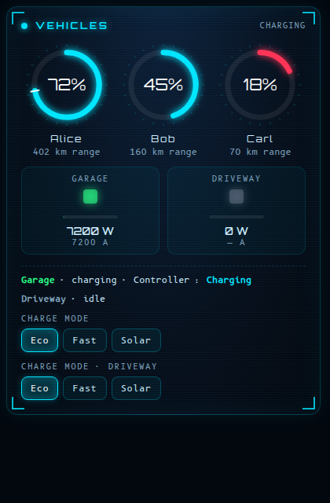

```yaml
chargers:
  - { name: Garage,   connected: sensor.garage_status,   charging: sensor.garage_status,   power: sensor.garage_power,   current: number.garage_current }
  - { name: Driveway, connected: sensor.driveway_status, charging: sensor.driveway_status, power: sensor.driveway_power, mode: select.driveway_mode }
```

**Works with any charger and car integration.** "Plugged in" and "charging" accept `on` / `off` but also the status words most chargers publish — `Charging`, `Connected`, `Plugged in`, `Awaiting start`, `SuspendedEV`, `Charge done`… (case, spaces and dashes are ignored). If your brand uses something unusual, list the words in `connected_states` / `charging_states`. No status sensor at all? The card falls back on the charger power (above 50 W = charging). The car's own `charging` entity accepts the same words (`charging_states` per car).

### sf-machines-card

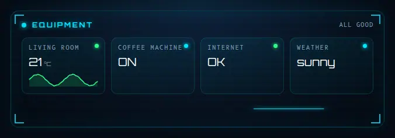

```yaml
type: custom:sf-machines-card
title: Equipment
tiles:
  - { label: NAS,    entity: sensor.nas_temperature, kind: value, digits: 0, warn: 55, crit: 65, max: 80 }
  - { label: Fridge, entity: sensor.fridge, kind: value, digits: 1, warn: 6, crit: 8 }
  - { label: Water,  entity: sensor.aquarium_temperature, kind: value, low: 24, warn: 26.5 }   # amber outside 24–26.5
  - { label: Pump,   entity: switch.pump, kind: toggle, color: "#4fc3f7" }
```

Tile kinds: `value`, `percent`, `binary`, `text`, `duration`, `timestamp`, `toggle`.

Mini-curve: `spark: true` (24 h) or `spark: <hours>` (1 to 168) on a `value` / `percent` tile draws its recent history under the figure (one request per distinct duration, refreshed every 5 minutes; nothing is drawn if the entity is unavailable).

Other tile options: `unit` (force the unit), `invert: true` (alert when the value is LOW), `ok_state` / `bad_text` (kind `binary`), `map` / `ok_values` (kind `text`: translate states / list the normal ones), `timer` / `stop` (kind `toggle`: remaining-time timer, and the entities switched off by a tap while it runs).

### sf-cells-card

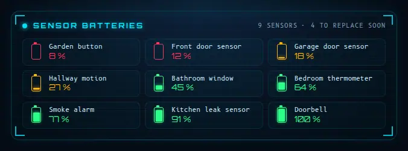

```yaml
type: custom:sf-cells-card
warn: 30
crit: 15
limit: 12                # default 16
exclude: [sensor.some_battery]
include_pattern: ""      # optional regex on the entity id (a group with alternatives repeated with + or * is refused, see the console)
exclude_pattern: ""      # optional regex: ignore matching entity ids
```

### sf-assistant-card

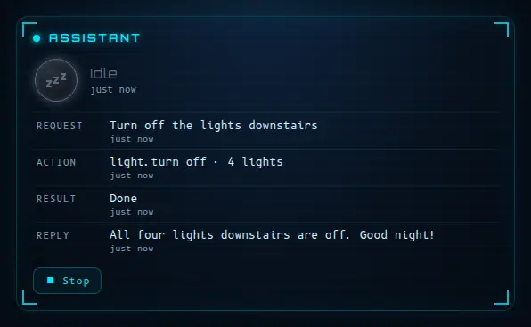

State of an assistant (voice or chat), read-only: its current phase (idle / listening / thinking / running / replying / error), the last request, the current action, its result and the last reply, plus optional action buttons. It works out of the box with Home Assistant **Assist satellites** (`assist_satellite.*`: idle / listening / processing / responding); for anything else, map the entity's states to phases with `phases`. The card interprets nothing — it shows what the entities contain (text capped at 300 characters, ages refreshed every minute).

```yaml
type: custom:sf-assistant-card
name: Assistant                              # optional
state: assist_satellite.kitchen              # entity whose state describes the activity
phases: { busy: acting, done: idle }         # optional: entity state -> idle | listening | thinking | acting | speaking | error
request: sensor.assistant_last_request       # optional text entities (their state is displayed)
action: sensor.assistant_current_action
result: sensor.assistant_last_result
reply: sensor.assistant_last_reply
actions:                                     # optional buttons (up to 6)
  - name: Stop
    icon: mdi:stop
    service: script.assistant_stop           # domain.service
    confirm: "Stop?"                         # optional: asks to press twice
```

### sf-host-card

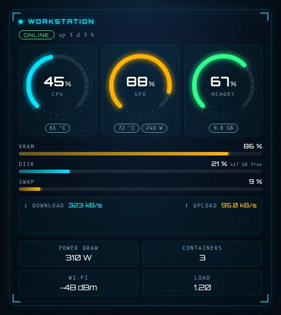 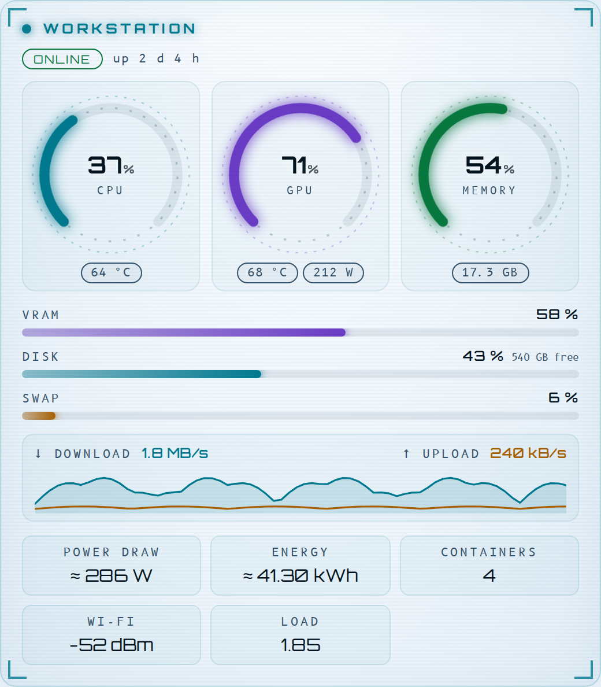

Monitoring of a computer or server from sensors you already have in Home Assistant (an MQTT discovery script, System Monitor, Glances, Proxmox…): three animated gauges (CPU, GPU, memory) with temperatures and power, bars for video memory, disk and swap, a live network curve, and a footer with power draw, energy, containers, Wi-Fi signal and load. Colours turn amber then red past your thresholds, and the whole card greys out when the host is offline. Every entity is optional; read-only.

```yaml
type: custom:sf-host-card
title: Workstation             # optional
online: binary_sensor.pc_online  # optional; without it the host is offline when no measurement is available
cpu: sensor.pc_cpu             # percent
cpu_temp: sensor.pc_cpu_temp
gpu: sensor.pc_gpu
gpu_temp: sensor.pc_gpu_temp
gpu_power: sensor.pc_gpu_power
gpu_vram: sensor.pc_vram_percent
ram: sensor.pc_ram_percent
ram_used: sensor.pc_ram_gb
swap: sensor.pc_swap
disk: sensor.pc_disk
disk_free: sensor.pc_disk_free
net_rx: sensor.pc_rx           # kB/s (B/s, MB/s, GB/s and Mbit/s units are converted)
net_tx: sensor.pc_tx
wifi: sensor.pc_wifi           # dBm
containers: sensor.pc_containers
load: sensor.pc_load
uptime: sensor.pc_uptime       # hours
power: sensor.pc_power         # total draw in W
energy_total: sensor.pc_energy # energy counter in kWh
power_estimate: true           # shows "≈" when power / energy are estimated rather than metered
warn: 75                       # amber from (percent), default 75
crit: 90                       # red from (percent), default 90
temp_warn: 75                  # amber from (°C), default 75
temp_crit: 88                  # red from (°C), default 88
```

The traffic curve is built from what the card sees while the page is open (no history request).

### sf-upkeep-card


**"When do I change that filter?"** Filters, brushes, salt, descaling, detectors at end of life — anything that wears out. Instead of a bare percentage, each item shows **when** it will need attention: the card learns the wear rate from the entity's own history (since the last reset, glitches ignored, long-term statistics used beyond the recorder's raw history) and projects the date. A timeline shows what is due in the coming weeks; the item due first leads the header. An optional reset button (press twice) restarts an item after a replacement. Works with a percentage left, a time left (h / min / d), a date (timestamp, `input_datetime`) or a "problem" binary sensor.

```yaml
type: custom:sf-upkeep-card
title: Upkeep
horizon: 30              # days shown on the timeline; items due within it are "to plan"
soon: 14                 # amber below this many days
learn_days: 180          # history used to learn the wear rate
items:
  - name: Purifier HEPA filter
    entity: sensor.purifier_filter_life      # % left
    reset: button.purifier_reset_filter      # optional (button, input_button, script or input_datetime)
    icon: mdi:air-filter
  - name: Robot vacuum brush
    entity: sensor.robot_main_brush_left     # time left in hours
    life: 300                                # full life in the entity's unit (otherwise the highest value seen)
  - name: Coffee machine descaling
    entity: input_datetime.last_descaling    # a date = the LAST service…
    every_days: 30                           # …the next one is due 30 days later
  - name: CO detector
    entity: binary_sensor.co_detector_end_of_life   # "on" = due now
```

### sf-air-card


**"Should I open the windows?"** One clear verdict — *open wide*, *quick airing*, *not needed*, *keep closed* — with its reasons and the best hour of the next 12. Moisture is compared in **absolute humidity** (g/m³): 80 % outside at 5 °C is drier than 55 % inside at 21 °C, so airing really does dry the house. It also weighs CO₂, indoor and outdoor fine particles (PM2.5), rain, wind, and whether opening would chill (or heat) the house.

- **One room or several.** With `rooms:` every room gets its own line and verdict, the outside is shared, and the most urgent room leads the window animation.
- **Open-plan spaces.** One sensor often covers several rooms (living room + kitchen + dining): list them in `areas` and they are shown under the room name.
- **Window sensors.** Add the room's window / door contacts in `openings`: the card confirms *airing* when it is the right time, says *close it* once a quick airing has lasted long enough, and *close it!* when the window should not be open at all.
- Thresholds can be set for the whole card or per room (a bathroom can tolerate more humidity).

```yaml
type: custom:sf-air-card
title: Fresh air
outdoor_temperature: sensor.outdoor_temperature   # or a weather entity alone
outdoor_humidity: sensor.outdoor_humidity
outdoor_pm25: sensor.outdoor_pm25                 # optional: polluted outside air blocks the verdict
wind: sensor.wind_speed                           # optional (km/h, m/s, mph and knots converted)
rain_chance: sensor.rain_chance                   # optional
weather: weather.home                             # optional: fallbacks + hourly forecast (best hour)
rooms:
  - name: Living area
    areas: [Living room, Kitchen, Dining]         # optional: open-plan spaces covered by the same sensors
    temperature: sensor.living_temperature
    humidity: sensor.living_humidity
    co2: sensor.living_co2                        # optional
    pm25: sensor.air_purifier_pm25                # optional: indoor fine particles
    openings: [binary_sensor.living_window, binary_sensor.patio_door]   # optional
  - name: Bathroom
    temperature: sensor.bathroom_temperature
    humidity: sensor.bathroom_humidity
    humidity_max: 70                              # per-room threshold (also comfort_min / comfort_max)
    openings: binary_sensor.bathroom_window
comfort_min: 19          # °C
comfort_max: 24
humidity_max: 60         # %
co2_max: 1000            # ppm
pm25_max: 25             # µg/m³ outside
pm25_in_max: 15          # µg/m³ inside
wind_max: 40             # km/h
```

For a single room you can skip `rooms:` and use `indoor_temperature`, `indoor_humidity`, `co2`, `indoor_pm25` and `openings` at the top level.

### sf-automations-card


**"Is everything still working?"** The health of your automations without opening the traces one by one: a health ring, counters, a 24-hour pulse of every run, and the list of what needs a look — **broken** (invalid configuration, error on the last run), pointing at an entity that is **unavailable or gone**, **silent** for too long, **disabled**, or **running** right now. Tap a line to open the automation. Reads the automation states, their latest traces and (for administrators) the entities each one uses; read-only.

```yaml
type: custom:sf-automations-card
title: Automations
stale_days: 30                 # enabled but not triggered for 30 days = silent (0 = never flag)
include: [automation.heating_*]   # optional patterns; exclude: [automation.test_*]
show_disabled: true            # list the disabled ones (otherwise only counted)
max_items: 8
check_entities: true           # look for unavailable / missing entities (admin only, every 15 min)
```

### sf-cycles-card


**"When will the washing machine be done?"** All you need is a smart plug that measures power. The card finds the cycles in the power history, then shows the one running — an animated drum, elapsed time, **expected end** learnt from the previous cycles, energy and cost so far — or the last one (finished X min ago, duration, kWh, cost), with the power curve and the week's count. Works for washing machines, dryers, dishwashers, ovens, towel heaters…

```yaml
type: custom:sf-cycles-card
title: Appliances
price: sensor.electricity_price      # €/kWh: an entity or a number (optional)
days: 7                              # history used (cycles, typical duration)
appliances:
  - name: Washing machine
    power: sensor.washing_machine_power   # W (kW converted)
    icon: mdi:washing-machine
  - name: Dishwasher
    power: sensor.dishwasher_power
    start: 8          # a cycle starts above 8 W…
    stop: 3           # …and ends below 3 W…
    stop_delay: 5     # …for 5 minutes (pauses in the middle are not mistaken for an end)
    min_minutes: 3    # shorter bursts are ignored
    done_hold: 120    # "finished" stays highlighted for 2 hours
```

### sf-health-card

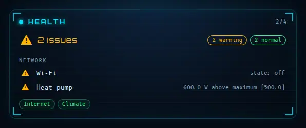

An overview of **your own checks**: you list entities and what is normal for each; the card gives one verdict (all good / warning / critical) and lists the anomalies, critical ones first, grouped so that ten alerts from one subsystem read as one. It decides nothing — it applies your rules to states Home Assistant already has (no request, no hidden calculation). An age check (`stale`) is re-evaluated every minute.

```yaml
type: custom:sf-health-card
title: Health                # optional
show_ok: false               # also list the normal checks
checks:                      # up to 60
  - name: Internet
    entity: binary_sensor.internet
    ok: ["on"]               # normal states; any other state is an anomaly
    severity: critical       # warning (default) | critical
    group: Network           # anomalies of one group are shown together
  - name: UPS
    entity: sensor.ups_battery
    min: 30                  # below = anomaly (max: above = anomaly)
  - name: Kitchen sensor
    entity: sensor.kitchen_temperature
    stale: 60                # no update for 60 min = anomaly
  - name: Leak
    entity: binary_sensor.leak
    bad: ["on"]              # abnormal states
    severity: critical
```

Rules of a check: unavailable / unknown is always an anomaly; then `ok`, `bad`, `min` / `max`, `stale`.

### sf-timeline-card

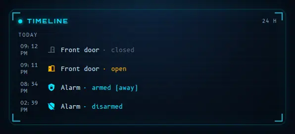

Read-only timeline of the latest state changes of the entities you choose (Home Assistant's logbook), grouped by day, with a plain sentence per entity type: door open / closed, motion detected, leak detected, alarm armed (home / away / night) or triggered, lock, presence… Alerts are coloured (red: leak, smoke, alarm triggered; amber: opening, unlocked). Nothing is computed or decided — it only shows the log. Loaded once, refreshed at most every 60 s; after an error, at most one retry per minute.

```yaml
type: custom:sf-timeline-card
title: Timeline            # optional
hours: 24                  # window shown
limit: 30                  # maximum number of events
group: true                # merge identical consecutive events ("× 3")
hide_unavailable: true
entities:                  # up to 40: an entity id, or an object
  - binary_sensor.front_door
  - entity: alarm_control_panel.home
    name: Alarm            # optional
    icon: mdi:shield-home  # optional
    color: "#ffb300"       # optional
  - entity: binary_sensor.hall_motion
    states: ["on"]         # optional: only show these states (here: motion detected, not "cleared")
    min_gap: 15            # optional: at least 15 minutes between two events of this entity (tames a flickering detector)
```

### sf-trend-card

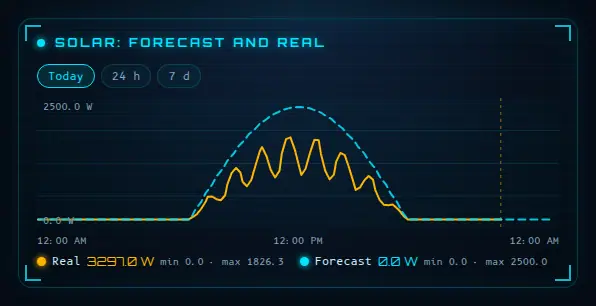

Read-only history curves in the HUD style — nothing is computed, the card draws what Home Assistant recorded. Series that share a unit are overlaid on one chart; series with different units get one line each (`layout` forces either). Range buttons switch the window; hover or touch a chart to read the value at that moment. Up to 48 h the full history is used; beyond that the long-term statistics (hourly mean), falling back to the history for an entity without statistics. Data is fetched once per range and refreshed at most every 2 minutes (10 minutes beyond 48 h); after an error it retries at most once a minute.

```yaml
type: custom:sf-trend-card
title: Temperatures
hours: 24                  # initial range
ranges: [6, 24, 168]       # range buttons, in hours ([] = no buttons)
layout: auto               # auto | combined | separate
height: 150                # px, 80 to 400
series:                    # up to 8
  - entity: sensor.living_room_temperature
    name: Living room      # optional
    color: "#00e5ff"       # optional, otherwise the first free colour of the palette
    unit: "°C"             # optional, otherwise the entity's unit
    digits: 1
    axis: left             # optional: right = second scale on the right (e.g. outdoor temperature next to indoor ones)
    factor: 1              # optional: multiplies the values (e.g. 1000 to compare a kW sensor with a forecast in W)
    attribute: watts       # optional: draw (dashed) a time-indexed attribute of the entity's CURRENT state instead of its history
```

**Forecast against reality.** `window: today` shows local midnight to midnight, so a forecast can extend into the future (a dashed marker shows "now"); `ranges: [today, 24, 168]` adds a "Today" button. With `attribute`, a series reads a time-indexed attribute such as the `watts` of a solar-forecast sensor (`{ "2026-11-03T10:00:00+01:00": 1200, … }`), drawn dashed, next to the real production read from the history:

```yaml
type: custom:sf-trend-card
title: Solar: forecast and real
window: today
ranges: [today, 24, 168]
series:
  - { entity: sensor.solar_power, name: Real, unit: W, factor: 1000 }   # a kW sensor, brought to W
  - { entity: sensor.energy_production_today, attribute: watts, name: Forecast, unit: W }
```

A series that did not change during the window (a parked car, a stable setpoint) is drawn as a flat line up to now. With `axis: right` on some series (and not on others) both scales are shown, left and right, on one chart.

### sf-battery-card

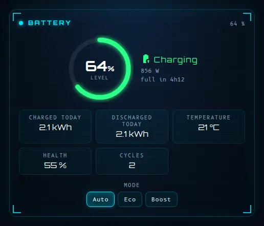

Home battery. Everything is optional — only configured entities are shown, and without `soc` or `power` the card hides itself.

```yaml
type: custom:sf-battery-card
title: Battery                             # optional
soc: sensor.battery_level                  # %
power: sensor.battery_power                # W, positive = discharging (invert: true to flip)
capacity_kwh: 10                           # enables "full in 3h10 / empty in …"
charged_today: sensor.battery_charged_today        # kWh
discharged_today: sensor.battery_discharged_today  # kWh
mode: select.battery_mode                  # optional mode selector (select or input_select)
temperature: sensor.battery_temperature
health: sensor.battery_health
cycles: sensor.battery_cycles
```

**Several batteries?** List them under `batteries`. The ring shows the overall level (weighted by each battery's capacity — a simple average if a capacity is missing), the power is the sum, the estimated time uses the total capacity, and one compact row per battery appears under the ring. A battery that is unavailable is simply left out of the average.

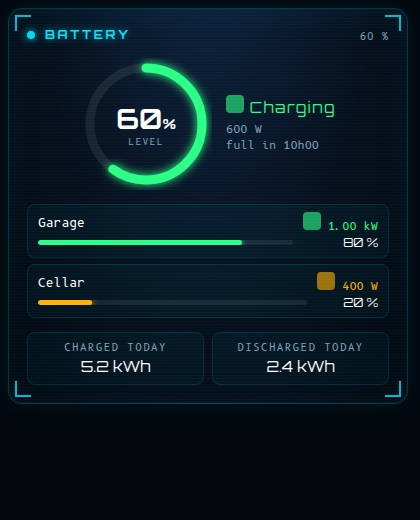

```yaml
type: custom:sf-battery-card
batteries:
  - { name: Garage, soc: sensor.garage_battery_level, power: sensor.garage_battery_power, capacity_kwh: 10 }
  - { name: Cellar, soc: sensor.cellar_battery_level, power: sensor.cellar_battery_power, capacity_kwh: 5 }
  # invert: true on a battery flips its power sign (positive = discharging by default)
charged_today: sensor.total_battery_charged_today      # optional totals, as above
```

The single-battery fields (`soc`, `power`, `capacity_kwh`) keep working. The card also works as a launcher popup, with `summary: battery`.

The **energy card** shows the battery as one node: `battery_power` / `battery_soc` for one battery, or the same `batteries:` list for several (overall level, summed power) — a node per battery would make the diagram unreadable.

### sf-radiators-card

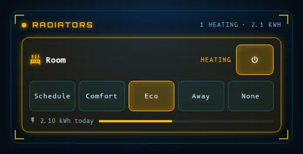

For radiators driven by presets (Voltalis, Netatmo, Tado…), which often have no room probe. One column and large touch targets, built for phones. Presets come from the device itself (`preset_modes`, or the options of a `select` entity); the setpoint buttons call `climate.set_temperature` and can be turned off for pilot-wire (fil pilote) heaters, which only know modes.

```yaml
type: custom:sf-radiators-card
title: Radiators
accent: "#e0875a"        # optional accent colour
step: 0.5                # setpoint step
max_kwh: 3               # daily energy that fills the bar
setpoint: true           # set false for pilot-wire heaters (no numeric setpoint): hides the ± control
preset_labels: { away: Frost protection }   # optional: rename presets
radiators:
  - name: Kitchen
    icon: mdi:countertop
    climate: climate.kitchen
    preset: select.kitchen_preset          # optional: use a select entity's options (may include "auto")
    presets: [auto, comfort, eco, away]    # optional: order / filter
    kwh: sensor.kitchen_energy_today       # optional (kWh or Wh)
    connection: sensor.kitchen_connection  # optional, warns when not ok/on/connected
```

### sf-camera-card

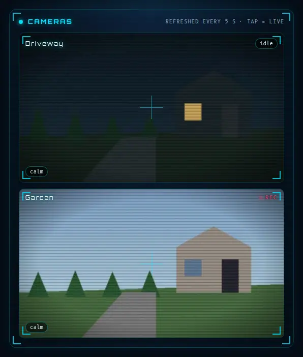

```yaml
type: custom:sf-camera-card
refresh: 5
cameras:
  - { entity: camera.front, name: Front, motion: binary_sensor.front_motion, persons: sensor.front_person_count, review: sensor.front_review_status }
```

### sf-setpoints-card

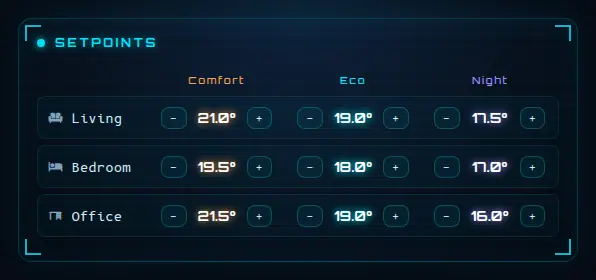

```yaml
type: custom:sf-setpoints-card
title: Setpoints
subtitle: Heating                  # optional
columns: [{ label: Day, color: "#ffb300" }, { label: Night, color: "#4fc3f7" }]
rows:
  - { name: Living room, icon: "mdi:sofa", entities: [input_number.living_day, input_number.living_night] }
```

### sf-ledger-card

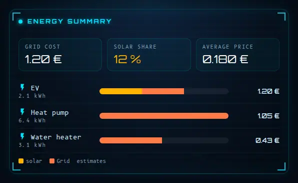

```yaml
type: custom:sf-ledger-card
period: input_select.energy_period
total_cost: sensor.energy_cost
solar_fraction: sensor.solar_fraction
avg_price: sensor.average_price
devices:
  - name: EV charger
    icon: mdi:car-electric
    total: sensor.ev_kwh          # period total
    edf: sensor.ev_kwh_grid       # part bought from the grid ("edf" is the historical key name)
    solar: sensor.ev_kwh_solar    # part supplied by solar
    cost: sensor.ev_cost
```

### sf-presence-card

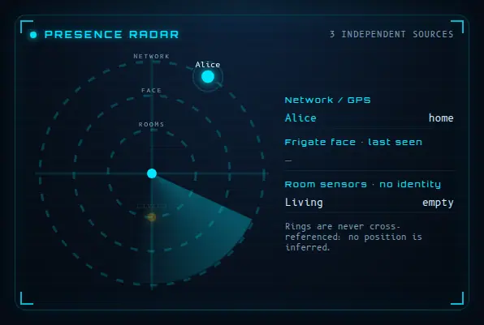

Advanced and opinionated: three rings, three sources that are **never merged** (home/away from `person.*`, last camera that recognised a face, anonymous room occupancy).

```yaml
type: custom:sf-presence-card
people: [{ name: Alice, person: person.alice, face: sensor.alice_last_camera, color: "#00e5ff" }]
rooms:  [{ label: Living room, entity: binary_sensor.living_room_occupancy }]
```

### sf-ns-card

A full‑screen card for small wall panels, tuned for the **Sonoff NSPanel Pro (480 × 480, square)** but sized in `vmin`, so it adapts to any screen. Tested (real screenshots, every mode) on every current Sonoff NSPanel screen size:

| Screen | Resolution | Result |
|---|---|---|
| NSPanel (original) | 480 × 320 | works, no overflow |
| NSPanel Pro / Pro Gen2 (86‑type, square) | 480 × 480 | works — the size it is designed around |
| NSPanel Pro 120‑type, landscape | 1334 × 750 | works, balanced |
| NSPanel Pro 120‑type, portrait | 750 × 1334 | works, but panels have more empty space than on the other sizes — this extreme a screen is not yet tuned for density |

(The 120‑type's exact resolution comes from a Sonoff test subdomain, not its final public spec sheet — treat it as indicative rather than a guarantee for that specific model.) It shows different things depending on the time of day:

| Mode | When (default) | What it shows |
|---|---|---|
| Morning | 06 – 09 | weather, **12‑hour rain chart** ("rain in 40 min" / "dry for 12 h"), vehicles (charge, range, lock), room temperatures, shortcuts |
| Day | 09 – 18 | solar orb with self‑use, three rich tiles (home, charger, grid with peak / off‑peak price and cost per hour), charger decision, fridge / freezer pills |
| Evening | 18 – 22 | big ambience tiles (lights, shutters, TV, scenes), **today's consumption, cost, solar share and comparison with yesterday**, vehicles |
| Night | 22 – 06 | "all clear" sentinel (leaks, locks), indoor / outdoor temperature, a "Good night" button that switches everything off |

Also: one alert line when something is wrong (leak, open lock, fridge too warm), a popup for a robot vacuum (shortcuts, return to base, stop), long‑press on any tile for the entity's history, confirmation on "turn everything off".

**Which mode?** Give it an `input_select` with the options `Morning / Day / Evening / Night` (or the French `Matin / Jour / Soir / Nuit`) and an automation of your choice — or leave `mode_entity` out and the mode simply follows the clock. Add `?mode=Evening` to the URL to preview a mode without changing anything.

**Kiosk mode.** Set `hide_header: true` to hide the Home Assistant header on that dashboard (add `?header=1` to the URL to bring it back). Use a dashboard view of type **panel** with this card alone.

```yaml
type: custom:sf-ns-card
mode_entity: input_select.panel_mode      # optional
weather: weather.home
outdoor: sensor.outdoor_temperature
hide_header: true
rooms:
  - { name: Living, icon: mdi:sofa, entity: sensor.living_temperature, min: 17 }
fridge:
  - { name: Fridge, icon: mdi:fridge, entity: sensor.fridge_temperature, max: 6 }
cars:
  - { name: Car A, color: "#00e5ff", soc: sensor.car_a_soc, range: sensor.car_a_range, lock: lock.car_a, charging: binary_sensor.car_a_charging, low: 20 }
tiles:                                    # up to 6, evening mode
  - { name: Living room, icon: mdi:sofa, color: "#ffb300", entity: light.living }
shortcuts:                                # buttons (morning mode + vacuum popup)
  - { name: Kitchen, icon: mdi:silverware-fork-knife, entity: button.vacuum_kitchen }
vacuum: { entity: vacuum.robot, battery: sensor.robot_battery, name: Vacuum }
lights_off: [light.living, light.bedroom]
cover: cover.shutters
scene_dim: scene.dimmed
energy:
  solar: sensor.solar_power
  home: sensor.home_power
  grid: sensor.grid_power                 # + = import, − = export
  ev: sensor.charger_power
  price: sensor.electricity_price
  hc_below: 0.15                          # a price below this is shown as off‑peak
  devices:                                # the two biggest are shown on the "home" tile
    - { name: Heat pump, entity: sensor.heat_pump_power, icon: mdi:heat-pump }
  day:                                    # "today" summary in the evening (long‑term statistics)
    import: sensor.grid_energy_import     # cumulative kWh counters
    export: sensor.grid_energy_export
    solar: sensor.solar_energy_total
    hp: 0.18                              # peak price per kWh
    hc: 0.14                              # off‑peak price per kWh
    hc_hours: [[0.9, 6.9], [14.4, 16.4]]  # off‑peak windows, decimal hours
```

Every entity is optional: a block without its entities is simply not displayed. The cost shown in the evening is an estimate (hourly statistics weighted by your off‑peak windows). Entity ids above are placeholders; the visual editor offers drop‑downs for everything except the free‑form `energy.devices` and `energy.day` objects, which are set in YAML.

**Rearranging a screen.** Each mode is built from a fixed set of named blocks. By default they appear in the order described in the table above, but you can reorder them with `layout` — for example to put the energy wheel on the right instead of the left:

```yaml
layout:
  jour: [energy_stats, energy_dec, energy_orb, fridge]   # was: energy_orb, energy_stats, energy_dec, fridge
```

Block names: `matin: [weather, cars, rooms, shortcuts]` · `jour: [energy_orb, energy_stats, energy_dec, fridge]` (only with `energy.solar` set) · `soir: [tiles, day, cars]` · `nuit: [sentinel, rooms]`. You only need to list the ones you want to move — anything you leave out keeps its place, nothing can disappear by a typo or an outdated list. Morning and Day keep a fixed 2×2 grid (reordering changes which of the 4 cells a block lands in — a block moved out of its usual, bigger cell gets the smaller one instead, the same way a real dashboard would resize it); Evening and Night size each row to what is actually in it, in the order you chose, so an unused block never leaves an empty gap.

**One combination to avoid:** on the Day screen, `energy_stats` (the three stacked Home / Charger / Grid tiles) is designed for the tall cell. Move `energy_orb` or `fridge` into the small cell instead — both were checked there and stay readable; `energy_stats` wasn't, and its text can run into itself if forced into the small cell.

The evening tiles (`tiles:`, up to 6) and this `layout` option were both verified with real screenshots at 2, 4 and 6 tiles and several custom orders, not just read from the code.

<p align="center"></p>

## Visual editor

Edit a dashboard, open any SF card and switch to the **visual editor**:

- fields are real Home Assistant pickers (entities filtered by domain, icons, numbers, toggles);
- lists (rooms, groups, items, tiles, devices, cameras…) have **+ Add**, **↑ / ↓** and a **two‑tap Delete** (the first tap arms it, so you can't delete by accident);
- in the launcher, each tile's popup content is chosen from a menu and edited with the *editor of that card*, nested;
- rarely used fields (service data, shortcuts…) are YAML boxes inside the form;
- the editor changes the configuration in place and never drops a field it doesn't know;
- **Fill from a device** — in the vehicle, charger and battery editors, pick a Home Assistant *device* and the empty fields are filled with its entities, found from their type (`device_class`, unit, name): battery level, range, power, plug, current… It is a **cautious** best guess: a field is only filled when exactly one entity matches or one matches the expected name (several candidates and no clear winner = left empty); it skips hidden entities, 12 V batteries, odometers, connectivity sensors and *pause / lock / schedule* switches; the sign of a battery's power is not guessed (check `invert`). It **never overwrites** a field you already filled, and a Home Assistant notification tells you how many fields were filled — always check the result. Needs Home Assistant's entity registry (`hass.entities`, Home Assistant 2023.3 or newer);
- every card has a **Theme** field (dark / light / auto).
- **Mandatory fields** are marked with a red bar and a red asterisk (for example the thermostat of a room, the camera of a camera entry). An amber banner at the top of the editor lists what is still missing, and a card with nothing useful to show displays **Card to complete** with the same list instead of an empty frame. The rules are lenient: only a card that would display nothing is flagged.

## Languages

The cards speak **English, French, Spanish, German, Dutch, Italian, Portuguese, Polish, Russian, Chinese (simplified) and Arabic**. The language follows the **Home Assistant profile of the person looking at the dashboard** (*Profile → Language*), so two users of the same dashboard can see two languages. If HA is set to any other language, the cards fall back to **English**. Date and time formats follow the same locale.

Regional variants (`pt-BR`, `zh-Hans`…) use the language of the same family. Arabic switches the cards to right-to-left; diagrams and dials keep their natural orientation.

Texts coming from your own configuration (titles, labels, names) are of course shown as you typed them.

> The languages were chosen from available proxies (Home Assistant publishes no usage statistics per language): the countries behind most downloads and website traffic, and the languages of the HA frontend. The translations were written by Claude; **native speakers are very welcome to review and correct them**.

Want another language? Translations live in one table (`SF_T`, near the top of `dist/sf-cards.js`: *key = French text → `[English, Spanish, German, Dutch, Italian, Portuguese, Polish, Russian, Chinese, Arabic]`*). Pull requests are welcome.

## Light theme

The cards are dark neon by default. For a light dashboard:

```yaml
type: custom:sf-energy-flow-card   # any SF card
theme: light                  # dark (default) | light | auto
```

- `auto` follows the Home Assistant theme: light when HA is in light mode, dark otherwise.
- **Set it once for every card**: add `sf-theme: light` (or `auto`) to your Home Assistant theme — HA turns every theme key into a CSS variable, here `--sf-theme` — then leave `theme` out of the cards (a `theme` set on a card always wins).
- The light variant is a **real palette** (not a colour inversion): every colour is a CSS custom property (`--sf-*`) defined for dark on `:host` and overridden for light, so text contrast, tints and glows are tuned for a light background and images/camera snapshots are never touched.
- In a launcher popup, the sheet gets a light look and SF cards switch to light themselves; other cards (standard Home Assistant cards) keep their own look.
- The wall-panel card (`sf-ns-card`) is dark-only by design (always-on screen).
- No filter is involved any more, so animations cost the same in both themes.

## Layout

The cards **adapt their arrangement to the room you give them** (their own width, not the screen's), and fill the height of their cell — something Home Assistant does not do for custom cards on its own. The energy flow and climate cards reorganise themselves; the tile cards (equipment, sensor batteries, radiators, cameras) use balanced columns; every card stretches to a taller cell.

<p align="center">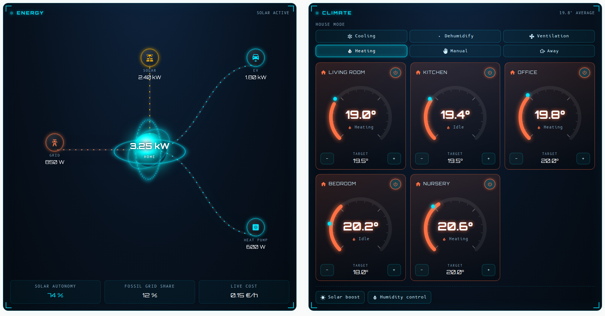</p>

- **Even rows**: house modes in as many columns as fit, evened out (6 modes → 3 + 3), rooms and tiles on balanced columns (5 → 3 + 2); icon-only modes when very narrow; long labels end with "…".
- **Equal heights** (sections view): drag the card's resize handle taller, or set `grid_options: { rows: 13 }`: the content takes the extra height (the energy flow spreads out, the rooms grow). Give the cards side by side the same number of rows and they line up (any SF card). In a cell shorter than the content the card scrolls instead of cutting controls off.
- Equal heights work in a **sections** view and in a **panel** view (the card fills the screen). Home Assistant does not stretch custom cards inside a `horizontal-stack`; use a sections view there.
- **Width in a section**: set `grid_options: { columns: full }` to use the whole width of a section of 2 or more columns (the Home Assistant default is half a section).
- It is safe: only a change in the number of columns triggers a redraw, never every pixel, so resizing cannot loop or restart the animations. `./test/run.sh` checks columns, overflow, equal heights and the absence of render loops.

## Accessibility

Everything clickable is a real button for keyboards and screen readers (role, focus ring, **Enter / Space**, a name read aloud, `aria-pressed` on selectors). Popups are dialogs: the focus moves in and comes back, **Esc** closes. Alert levels are spelled out ("critical", "warning") instead of relying on colour alone. With *reduce motion* enabled in your system, animations are switched off, and touch screens get larger tap targets.

## Numbers

Decimals follow the language of your Home Assistant profile (`20,5 °C` in French, `20.5 °C` in English), with Latin digits everywhere and no thousands separator.

## Optional theme

[`themes/sf_hud.yaml`](themes/sf_hud.yaml) dresses the **native** Home Assistant cards (history graphs, logbook, entities lists…) in the same colours. Copy it to `/config/themes/` (with `frontend: themes: !include_dir_merge_named themes` in `configuration.yaml`), reload themes, then set `theme: SF HUD` on a view.

## Requirements

- **Home Assistant**: any recent version. The *Fill from a device* editor feature needs the entity registry in the frontend (about 2023.3 and newer); everything else only needs the standard card API.
- **Browser**: Chrome / Edge 111+, Safari 16.2+, Firefox 113+ (the cards use `color-mix`; the Home Assistant mobile apps follow their system web view).
- No extra resources: the cards and their fonts are one file; they only load what your Home Assistant provides (for instance camera pictures).

## Security

Text that comes from entities (names, states, units, picture URLs) is always escaped before it is displayed and never interpreted as HTML; image URLs must start with `/`, `http://`, `https://` or be a base64 `data:image/` (PNG, JPEG, GIF, WebP) — never `javascript:`. All values from the configuration that end up in HTML attributes are escaped too, CSS values (`color`, `accent`, `span`) only accept safe forms (hex, colour name, `rgb()` / `hsl()`, `var(--x)`), and regular expressions (`include_pattern` / `exclude_pattern`) are limited and refused when they could freeze the browser. The charger controls are off unless you set `controls: true`. The cards only call the Home Assistant services you configured (`switch`, `number`, `select`, `scene`, `script`, `climate`, `light`, `cover`…) with the entities you configured. **Treat shared YAML like shared code:** like Home Assistant's own `call-service` tap action, an `action` item or a `switch_script` calls whatever service its configuration says, under whatever label it shows — read a configuration you copied from the internet before pasting it. Please report a vulnerability privately through GitHub's *Security → Report a vulnerability*.

## Development

```bash
./test/run.sh    # syntax + render of every card (11 languages, no-solar and empty scenarios, translations, editors, accessibility, themes, popups) in headless Chrome
```

See the [changelog](CHANGELOG.md) for what changed in each version.

## About HACS and Marketplace

Since **Home Assistant 2026.11**, HACS ships inside Core as **Marketplace**. Existing HACS installations (repositories, update entities, dashboard resources) are migrated automatically, and SF Cards is listed in the default catalogue there. Custom cards are still community content: Home Assistant does not test or support them.

SF Cards is a plain JavaScript dashboard resource, so it works the same way with Marketplace, with HACS on older versions, or installed manually.

Sources: [Matter Alpha — "Home Assistant embraces HACS into core as the marketplace"](https://www.matteralpha.com/news/home-assistant-embraces-hacs-into-core-as-the-marketplace) · [Home Assistant community thread on integrating popular HACS custom cards into standard cards](https://community.home-assistant.io/t/integrating-popular-frontend-custom-cards-on-hacs-to-standard-ha-cards/741706).

## Limitations

- Developed and tested on **Home Assistant 2026.11** (Chrome and the iOS / Android companion apps). Older versions may work but have not been tried.
- The code comments in `dist/sf-cards.js` are still in French (the UI itself is translated).
- Screenshots use fictional demo data.
- Automated render tests (`./test/run.sh`, headless Chrome) cover every card, the visual editors (with a mock `ha-form`) and the 11 languages; everything was also tried on real installations. Home Assistant itself is not part of the tests.
- `sf-presence-card` and the Frigate‑related options are tied to a specific setup and are documented as advanced.

## Credits

- **Written by Claude** (Anthropic — Claude Sonnet 5.5, through Claude Code): the cards, the visual editors, the translations, the screenshots pipeline, this README.
- **Ideas, direction, testing and feedback: [khrom06](https://github.com/khrom06)** — the sci‑fi look, the phone popups, the dynamic energy layout, the "hide what consumes nothing" idea, the languages, and a long list of *"what if we…?"* that shaped every card. Many of the best details here are theirs.
- Fonts: **Orbitron** (© The Orbitron Project Authors) and **B612 Mono** (© The B612 Project Authors), both under the SIL Open Font License 1.1 — see [THIRD_PARTY_NOTICES.md](THIRD_PARTY_NOTICES.md).
- Icons: Home Assistant's Material Design Icons.

## License

[MIT](LICENSE) © khrom06. Embedded fonts are under the [SIL OFL 1.1](THIRD_PARTY_NOTICES.md).
